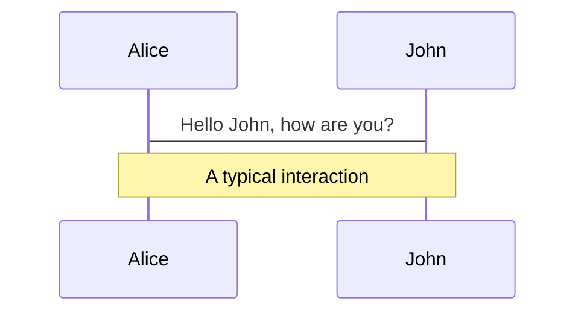
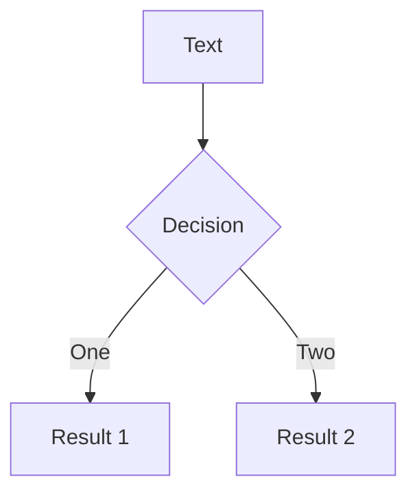
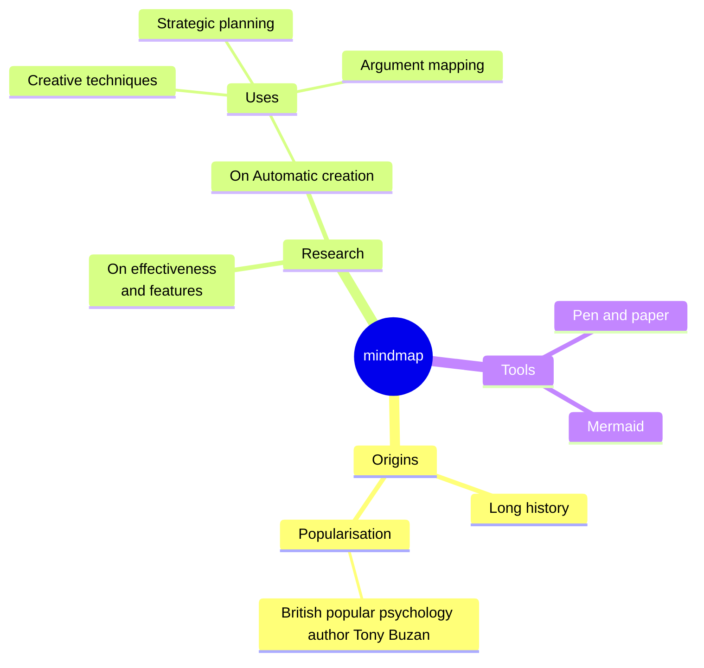

---
# === EDIT THESE INFORMATIONS ===
# title of your slide, will inferred from the first header if not specified
# (use search&replace to update)
title: Super Title

# slides description
# (use search&replace to update)
info: Talk description

# URL of the presentation
# (use search&replace to update)
url: https://slides.com/feoche/les-bookmarklets-c-est-chouette

# date of the presentation
date: 2024-06-21

# keywords field for exported PDF, comma-delimited
keywords: keyword1,keyword2

# force color schema for the slides, can be 'auto', 'light', or 'dark'
colorSchema: auto

# duration of the presentation
duration: 30min

# HTML tag attributes
htmlAttrs:
  dir: ltr
  lang: fr

# SEO meta tags
seoMeta:
  ogTitle: Super Title
  twitterTitle: Super Title
  ogDescription: Talk description
  twitterDescription: Talk description

  ogImage: https://www.iamfy.co/cdn/shop/files/m_2Fx1000_2F25dccac9-6ec7-490d-9c7d-5b02facba143_fe3c11a6-046f-402a-bdfa-38a1dcdbc0e4.jpg?crop=center&height=1000&v=1761237025&width=750&quality=60
  ogUrl: https://slides.com/feoche/les-bookmarklets-c-est-chouette
  twitterCard: summary_large_image
  twitterImage: https://pbs.twimg.com/profile_images/1881465971619119105/PdAr46fd_400x400.jpg
  twitterSite: francoiseoche
  twitterUrl: https://x.com/francoiseoche

# theme id, package name, or local path
# Learn more: https://sli.dev/guide/theme-addon.html#use-theme
theme: "./src/_theme"
hideInToc: true
addons:
  - slidev-addon-qrcode
---

# {{ $frontmatter.title }}

### {{ $slidev.configs.author }}

::qr-code::
<QRCode
    class="qr-code"
    :width="200"
    :height="200"
    type="svg"
    :data="$frontmatter.url"
    color="transparent"
    :dotsOptions="{ color: 'white' }"
/>

<!-- Speaker Notes -->

---
layout: intro
image: https://francoiseoche.fr/assets/avatar.webp
---

## {{ $slidev.configs.author }}

### Web cabinetmaker

* Product Owner chez OVHcloud - Design System
* Référent accessibilité numérique
* Développeur "front-of-the-front-end" (web & hybride)
* Orga de RennesJS, CSScade
* Passionné d'ergonomie des interfaces

<a href="https://francoiseoche.fr/" target="_blank" aria-label="Site web de {{ $slidev.configs.author }} - Ouvre dans un nouvel onglet">
  francoiseoche.fr
</a>

<!-- Speaker Notes -->

---
layout: disclaimer
---

## Disclaimer

Cette présentation vous confronte au biais du conférencier. Veuillez noter que ce belâtre d'orateur n'est probablement
pas plus légitime que vous en termes d'expertise ni d'omniscience.

On a tous à apprendre les uns des autres, et ça n'est pas qu'une question de syndrôme de l'imposteur.

Éventuellement, de l'humour (discutable) sera aussi énoncé dans ces slides ou par le conférencier. Si vous n'êtes pas
familier avec le concept, demandez conseil à votre pharmacien.

Arrêtez donc de lire ceci et écoutez l'énergumène qui déblatère et gesticule, s'il vous plaît. Promis, il n'y aura pas
d'examen à la fin (ni d'autres slides aussi longues).

Lorem ipsum dolor sit amet, consectetur adipiscing elit e que s'apelerio Quézac.

<small>**PS:** Oui, cette diapositive n'est pas accessible, merci pour les deux du fond qui ne voient rien</small>

<!-- 
Avant de commencer : le simple fait de prendre la parole sur cette scène ne fait pas de moi un expert ni une autorité absolue – c’est simplement l’expression du biais d’autorité (ou, pour faire court, du “biais du conférencier”), et j’ai préféré l’anticiper plutôt que de vous le laisser deviner. 
-->

---
hideInToc: true
---

## Sommaire

<Toc maxDepth="1"></Toc>

<!-- Speaker Notes -->

---
layout: section
---

# Introduction
### A cool subtitle

This layout is used to introduce sections or chapters.

<!-- Speaker Notes -->

---
layout: default
---

## Default Layout
### A cool subtitle

- Lorem ipsum dolor sit amet, consectetur adipiscing elit.
- Sed do eiusmod tempor incididunt ut labore et dolore magna aliqua.
- Ut enim ad minim veniam, quis nostrud exercitation ullamco laboris nisi ut aliquip ex ea commodo consequat.
- Duis aute irure dolor in reprehenderit in voluptate velit esse cillum dolore eu fugiat nulla pariatur.
- Excepteur sint occaecat cupidatat non proident.

<!-- Speaker Notes -->

---

## Table example

| Col 1 | Col 2 | Col 3 | Col 4 | Col 5 |
|-------|-------|-------|-------|-------|
| Data  | Data  | Data  | Data  | Data  |
| Data  | Data  | Data  | Data  | Data  |
| Data  | Data  | Data  | Data  | Data  |

---

## Code Slide Example

Here's an example of a code slide with syntax highlighting:

<!-- Code snippet -->
<<< @/src/_theme/layoutHelper.ts [src/_theme/layoutHelper.ts] {lineNumbers:true,maxHeight:'100%'} ts

```ts {monaco}
const result = helloWorld();
```

```ts {monaco-run}
console.log(new Date().toUTCString());
```

```ts {monaco-diff}
const result = helloWorld("true");
~~~
const result = helloWorld("false");
```

<!-- Speaker Notes -->

---
layout: full
---

## Full Layout
### A cool subtitle

This layout uses the entire slide area for content.

<!-- Speaker Notes -->

---
layout: center
---

## Center Layout
### A cool subtitle

Presentation slides for developers

<!-- Speaker Notes -->

---
layout: fact
---

## Fact Layout
### A cool subtitle

This layout is designed for presenting facts or statistics.

<!-- Speaker Notes -->

---
layout: quote
---

## Quote Layout
### A cool subtitle

> "The only way to do great work is to love what you do."
>
> — Steve Jobs

<!-- Speaker Notes -->

---
layout: media-full
src: https://www.iamfy.co/cdn/shop/files/m_2Fx1000_2F25dccac9-6ec7-490d-9c7d-5b02facba143_fe3c11a6-046f-402a-bdfa-38a1dcdbc0e4.jpg?crop=center&height=1000&v=1761237025&width=750&quality=60
backgroundSize: contain
---

<!-- Speaker Notes -->

---
layout: media
src: https://www.iamfy.co/cdn/shop/files/m_2Fx1000_2F25dccac9-6ec7-490d-9c7d-5b02facba143_fe3c11a6-046f-402a-bdfa-38a1dcdbc0e4.jpg?crop=center&height=1000&v=1761237025&width=750&quality=60
---

## Media

<!-- Speaker Notes -->

---
layout: media-left
src: "https://www.iamfy.co/cdn/shop/files/m_2Fx1000_2F25dccac9-6ec7-490d-9c7d-5b02facba143_fe3c11a6-046f-402a-bdfa-38a1dcdbc0e4.jpg?crop=center&height=1000&v=1761237025&width=750&quality=60"
---

## Media Left
### A cool subtitle

This is an image on the left

<!-- Speaker Notes -->

---
layout: media-right
src: "https://www.iamfy.co/cdn/shop/files/m_2Fx1000_2F25dccac9-6ec7-490d-9c7d-5b02facba143_fe3c11a6-046f-402a-bdfa-38a1dcdbc0e4.jpg?crop=center&height=1000&v=1761237025&width=750&quality=60"
---

## Media Right
### A cool subtitle

This is an image on the right

---
layout: media-full
window: true
src: https://francoiseoche.fr/
windowTitle: Website
---

<!-- Speaker Notes -->

---
layout: media
window: true
src: https://francoiseoche.fr/
windowTitle: Website
---

## Media Window

<!-- Speaker Notes -->

---
layout: media-left
window: true
src: https://francoiseoche.fr/
windowTitle: Website
---

## Media Window Left
### A cool subtitle

This is an iframe on the left

<!-- Speaker Notes -->

---
layout: media-right
window: true
src: https://francoiseoche.fr/
windowTitle: Website
---

## Media Window Right
### A cool subtitle

This is an iframe on the right

<!-- Speaker Notes -->

---
layout: media
window: true
src: https://www.iamfy.co/cdn/shop/files/m_2Fx1000_2F25dccac9-6ec7-490d-9c7d-5b02facba143_fe3c11a6-046f-402a-bdfa-38a1dcdbc0e4.jpg?crop=center&height=1000&v=1761237025&width=750&quality=60
---

## Media Window (portrait → mobile frame)

<!-- Speaker Notes -->

---
layout: two-cols
---

## Left
### A cool subtitle

This shows on the left

::right::

## Right
### A cool subtitle

This shows on the right

<!-- Speaker Notes -->

---
layout: two-cols-header
---

## This spans both
### A cool subtitle

::left::

### Left

This shows on the left

::right::

### Right

This shows on the right

::bottom::

#### This spans both - Lorem ipsum dolor sit amet, consectetur adipiscing elit.

<!-- Speaker Notes -->

---
layout: three-cols
---

::left::

### Left

This shows on the left

::center::

### Center

This shows in the center

::right::

### Right

This shows on the right

::bottom::

#### This spans all three columns

<!-- Speaker Notes -->

---
layout: three-cols-header
---

## This spans all columns
### A cool subtitle

::left::

### Left

This shows on the left

::center::

### Center

This shows in the center

::right::

### Right

This shows on the right

<!-- Speaker Notes -->

---
layout: three-rows
---

::top::

### Top

This shows on the top

::center::

### Center

This shows in the center

::bottom::

### Bottom

This shows on the bottom

<!-- Speaker Notes -->

---
layout: six-cells-header
---

## This spans all cells
### A cool subtitle

::top-left::

#### Top left

::top-center::

#### Top center

::top-right::

#### Top right

::bottom-left::

#### Bottom left

::bottom-center::

#### Bottom center

::bottom-right::

#### Bottom right

<!-- Speaker Notes -->

---
foo: bar
dragPos:
  square: 0,-101,0,0
square: 691,32,167,_,-16
---

## Draggable Elements

Double-click on the draggable elements to edit their positions.

<br>

###### Directive Usage

```vue

```

<br>

###### Component Usage

```vue
<v-drag text-3xl>
  <div class="i-carbon:arrow-up"
           />
  Use the `v-drag` component to have a draggable container!
</v-drag>
```

<v-drag pos="612,188,261,_,-15">
  <div text-center text-3xl border border-main rounded>
    Double-click me!
  </div>
</v-drag>


###### Draggable Arrow

```md
<v-drag-arrow two-way />
```
<v-drag-arrow pos="170,473,-61,-183"
           two-way op70 />

---

## Diagrams

You can create diagrams / graphs from textual descriptions, directly in your Markdown.

<div class="grid grid-cols-4 gap-5 -mb-6">







```plantuml {scale: 0.7}
@startuml

package "Some Group"
           {
  HTTP - [First Component]
  [Another Component]
}

node "Other Groups"
           {
  FTP - [Second Component]
  [First Component] --> FTP
}

cloud {
  [Example 1]
}

database "MySql"
           {
  folder "This is my folder"
           {
    [Folder 3]
  }
  frame "Foo"
           {
    [Frame 4]
  }
}

[Another Component] --> [Example 1]
[Example 1] --> [Folder 3]
[Folder 3] --> [Frame 4]

@enduml
```

</div>

Learn more: [Mermaid Diagrams](https://sli.dev/features/mermaid) and [PlantUML Diagrams](https://sli.dev/features/plantuml)

---
layout: end
image: https://francoiseoche.fr/assets/avatar.webp
hideInToc: true
---

::main::
<ul>
    <li>
        <h5 class="inline">Website :</h5>&nbsp;
        <a href="https://francoiseoche.fr/"
           target="_blank"
           aria-label="Site web de {{ $slidev.configs.author }} - Ouvre dans un nouvel onglet">
            francoiseoche.fr
        </a>
    </li>
    <li>
        <h5 class="inline">LinkedIn :</h5>&nbsp;
        <a href="https://www.linkedin.com/in/feoche/"
           target="_blank"
           aria-label="Profil LinkedIn - Ouvre dans un nouvel onglet">
            in/feoche
        </a>
    </li>
    <li>
        <h5 class="inline">Github :</h5>&nbsp;
        <a href="https://github.com/feoche"
           target="_blank"
           aria-label="Profil Github - Ouvre dans un nouvel onglet">
            @feoche
        </a>
    </li>
    <li>
        <h5 class="inline">X :</h5>&nbsp;
        <a href="https://x.com/francoiseoche"
           target="_blank"
           aria-label="Profil X - Ouvre dans un nouvel onglet">
            @francoiseoche
        </a>
    </li>
</ul>

::feedback::
<span class="flex place-items-center h-full">
    <small class="mx-auto text-6xl fw-600">Merci !</small>
</span>

::qr-code::
##### Feedback :

<QRCode
    class="qr-code mx-auto"
    :width="250"
    :height="250"
    type="svg"
    data="https://francoiseoche.fr"
    :margin="0"
    color="transparent"
    :dotsOptions="{ color: 'white' }"
/>

<!-- Speaker Notes -->
