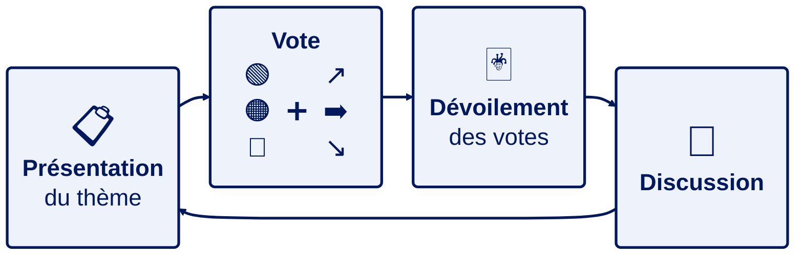

---
# === EDIT THESE INFORMATIONS ===
# title of your slide, will inferred from the first header if not specified
# (use search&replace to update)
title: "Squad Health Check - Le radar de votre équipe"

# slides description
# (use search&replace to update)
info: "Votre équipe avance, encore et toujours, mais quelque chose coince. Les délais glissent, les tensions montent... Les signaux sont là, mais restent assez flous. L'atelier du Squad Health Check met des mots clairs sur ces signaux, en faisant émerger perceptions et sentiments de chacun sans jugement. Vous verrez dans ce talk comment mesurer et détecter rapidement les points bloquants d'une équipe vue sous toutes ses coutures, afin de permettre de lancer des actions concrètes pour assurer la bonne santé de l'équipe."

# short summary of the talk, on its website card (default: info)
summary: "Un atelier pour mettre des mots clairs sur la santé de votre équipe, sans jugement, et lancer des actions concrètes."

# where the talk is given, on its website card
event: Codeurs en Seine

# URL of the presentation (used by the cover QR code)
url: https://www.codeursenseine.com/2026/programme/quicky-a-1-squad-health-check-le-radar-de-votre-equipe-francois-eoche

# date of the presentation (shown on the cover)
date: 2026-11-19

# keywords field for exported PDF, comma-delimited
keywords: agilité, atelier, équipe

# force color schema for the slides, can be 'auto', 'light', or 'dark'
colorSchema: light

# duration of the presentation
duration: 15min

# HTML tag attributes
htmlAttrs:
  dir: ltr
  lang: fr

# SEO meta tags
seoMeta:
  ogTitle: "Squad Health Check - Le radar de votre équipe"
  twitterTitle: "Squad Health Check - Le radar de votre équipe"
  ogDescription: "Votre équipe avance, encore et toujours, mais quelque chose coince. Les délais glissent, les tensions montent... Les signaux sont là, mais restent assez flous. L'atelier du Squad Health Check met des mots clairs sur ces signaux, en faisant émerger perceptions et sentiments de chacun sans jugement. Vous verrez dans ce talk comment mesurer et détecter rapidement les points bloquants d'une équipe vue sous toutes ses coutures, afin de permettre de lancer des actions concrètes pour assurer la bonne santé de l'équipe."
  twitterDescription: "Votre équipe avance, encore et toujours, mais quelque chose coince. Les délais glissent, les tensions montent... Les signaux sont là, mais restent assez flous. L'atelier du Squad Health Check met des mots clairs sur ces signaux, en faisant émerger perceptions et sentiments de chacun sans jugement. Vous verrez dans ce talk comment mesurer et détecter rapidement les points bloquants d'une équipe vue sous toutes ses coutures, afin de permettre de lancer des actions concrètes pour assurer la bonne santé de l'équipe."
  ogUrl: https://www.codeursenseine.com/2026/programme/quicky-a-1-squad-health-check-le-radar-de-votre-equipe-francois-eoche
  twitterCard: summary_large_image
  twitterSite: francoiseoche
  twitterUrl: https://x.com/francoiseoche

# theme id, package name, or local path
# Learn more: https://sli.dev/guide/theme-addon.html#use-theme
theme: "../../../src/theme"
# override the theme palette (OVHcloud Design System colors)
themeConfig:
  primary: "#00185E"
  secondary: "#0d3679"
  light: "#ffffff"
  link: "#0050d7"
  highlight-link: "#ffffff"
layout: cover
hideInToc: true
addons:
  - slidev-addon-qrcode
---

# Squad Health Check Le radar de votre équipe

### {{ $slidev.configs.author }}

::qr-code::
<MediaEl :src="'qr:' + $frontmatter.url"/>

<!-- Speaker Notes -->

---
src: ../../../src/common/intro.md
---

---

## On commence par un exercice 

### Levez la main si...

🤚 Vous pensez que votre **équipe** va bien  

<v-clicks>

### Gardez la main levée si... 

🤚 **Les gens** se sentent bien dans l'équipe  

🤚 Vous êtes en capacité de le **prouver** et le **mesurer**

</v-clicks>

---

## La situation, vous la connaissez.

- "Ça va ?" **"Ça va."**
- Le travail devient **monotone**, l'ambiance très **pesante**
- On ne se **parle plus** vraiment
- Les tâches prennent **+ de temps**, le **sprint glisse**
- Un **mal-être** général <small>(des arrêts de travail, qui sait ?)</small>

---
layout: center
---

## On a une "impression" mais pas de mesure

<!-- Une fois qu'on a dit ça, c'est bien, mais à défendre aux managers ou aux RH...ça n'est pas la même -->

---
layout: center
---

## Et si on rendait ça (plus) lisible ?
 

🟩 🔶 🔴

---

## Squad Health Check, c'est quoi ?
- Lancé chez **Spotify** en **2014** <small>(Henrik Kniberg & Kristian Lindwall)</small>
- Un atelier Agile pour :
  * Mesurer l'**état de santé** de l'équipe
  * **Prendre du recul** sur le quotidien
  * L'**améliorer** en continu

---
layout: section
---

# Présentation de l'atelier

---

## L'atelier Squad Health Check

* Un ensemble de **thèmes** <small>(ici ceux de Spotify)</small>

  
Rapidité

  
Mission

  
Support

  
Valeur délivrée

  
Facilité à livrer

  
Apprentissage

  
Pions ou joueurs

  
Santé du code

  
Process

  
Fun

  
Travail d'équipe

---

## Un round de Squad Health Check
###

×10

<!-- Vert ne signifie pas forcément que tout est parfait. Cela signifie simplement que l'équipe est satisfaite et ne voit pas de besoin majeur d'amélioration pour le moment. -->
<!-- Orange signifie qu'il y a quelques problèmes à résoudre, mais que ce n'est pas catastrophique. -->
<!-- Rouge signifie que quelque chose ne va vraiment pas et doit être amélioré. -->

---

## Dans chaque thème
### Ex. : Valeur délivrée

  

    
🔴 Rouge

    Nous livrons de la camelote.  Nous avons honte de la livrer.  Nos parties prenantes nous détestent.
  

  

    
🟩 Vert

    Nous livrons du super travail !  Nous en sommes fiers et nos parties prenantes sont très satisfaites.
  

<!--
Exemples vert / rouge tirés des cartes Spotify (traduits).
Le orange est volontairement omis pour permettre la nuance entre le rouge et le vert.
-->

---
layout: media
media: visio.jpg
---

## Vote en visio <small>(équipe Domain)</small>

<!---
### Matériel :
* **Tableau blanc/écran**
* **Caméras** (si en ligne)
* Des **objets de couleur** et nos **mains** 

### Rôles :
* Un **médiateur** <small>(membre de l'équipe ou non)</small>
* Le **reste de l'équipe** <small>(sans le management)</small>
-->

---

## Format de l'atelier

### Durée :
* **Prendre le temps**
* Pas de **durée max** par thème
* Idéalement, environ **2h**

### Récurrence :

- Ponctuel : nouvel **arrivant**, nouvelle **organisation**
- Régulier : tous les **trimestres**, ou après une livraison **majeure**

<!-- Durée : entre 1h et 4h maximum -->
<!-- Récurrence : entre 2 mois et 6 mois -->

---

## Toute l'équipe
### ...sans exception

* 10 personnes **max**
* **Focus** sur l'atelier !
* Implication et participation **équitable** de tous
* Discussion **sans jugement**, pas de **débat**

<small>(Management : optionnel, et non recommandé)</small>

<!-- Validé par le médiateur et par l'équipe -->

---

## Le médiateur
### Un rôle important

* **"Président de séance"** (et un peu timekeeper)
* S'assure des **temps de parole**  
**À la fin** :
  * Synthétise l'atelier dans un **compte-rendu** concis
  * Regarde **la tendance** avec les sessions précédentes
  * Partage le résumé **anonymisé** avec la **hiérarchie**

---

## Résultat chez Spotify

| | Squad 1 | Squad 2 | Squad 3 | Squad 4 | Squad 5 | Squad 6 | Squad 7 |
|---|:-:|:-:|:-:|:-:|:-:|:-:|:-:|
| Support | <i class="g"></i> | <i class="y"></i> | <i class="g"></i> | <i class="g"></i> | <i class="g"></i> | <i class="y d"></i> | <i class="g"></i> |
| Travail d'équipe | <i class="g u"></i> | <i class="y u"></i> | <i class="y"></i> | <i class="g"></i> | <i class="g"></i> | <i class="y"></i> | <i class="y u"></i> |
| Pions ou joueurs | <i class="g d"></i> | <i class="r u"></i> | <i class="y"></i> | <i class="g u"></i> | <i class="g"></i> | <i class="y"></i> | <i class="y u"></i> |
| Mission | <i class="g"></i> | <i class="r u"></i> | <i class="g"></i> | <i class="g u"></i> | <i class="g"></i> | <i class="g"></i> | <i class="g u"></i> |
| Santé du code | <i class="r"></i> | <i class="r u"></i> | <i class="g"></i> | <i class="y u"></i> | <i class="y u"></i> | <i class="r"></i> | <i class="r u"></i> |
| Process | <i class="g"></i> | <i class="r"></i> | <i class="g"></i> | <i class="g u"></i> | <i class="g"></i> | <i class="y u"></i> | <i class="y u"></i> |
| Valeur délivrée | <i class="n"></i> | <i class="y u"></i> | <i class="g"></i> | <i class="g u"></i> | <i class="g"></i> | <i class="g u"></i> | <i class="y u"></i> |
| Apprentissage | <i class="g u"></i> | <i class="y u"></i> | <i class="y"></i> | <i class="g u"></i> | <i class="y"></i> | <i class="y"></i> | <i class="g u"></i> |
| Rapidité | <i class="y u"></i> | <i class="r u"></i> | <i class="y"></i> | <i class="y u"></i> | <i class="y"></i> | <i class="y"></i> | <i class="y u"></i> |
| Facilité à livrer | <i class="y"></i> | <i class="r"></i> | <i class="y"></i> | <i class="y u"></i> | <i class="y"></i> | <i class="r u"></i> | <i class="y u"></i> |
| Fun | <i class="g u"></i> | <i class="g u"></i> | <i class="g"></i> | <i class="g u"></i> | <i class="g"></i> | <i class="g"></i> | <i class="g u"></i> |

---
layout: section
---

# Chez OVHcloud

<!-- **Plusieurs équipes** l'utilisent en interne 
**Inspiration** de la méthode de Spotify 
De manière **"classique"** ou **customisée** -->

---

## Squad Health Check (à notre sauce)

* Les **exemples** des catégories ne nous convenaient pas :

  

    🔴 Nous n'avons aucune idée de pourquoi nous sommes là, <strong>il n'y a ni vision d'ensemble ni cap</strong>.
  

  

    🟩 Nous savons exactement pourquoi nous sommes là, <strong>et ça nous enthousiasme vraiment</strong>.
  

  

<v-clicks>

* On a créé **15 nouvelles catégories** en retravaillant les sujets 
* Puis un **mode asynchrone** pour se concentrer sur l'échange
* Et un système de vote avec une **échelle de notes (1-9)**
* Et...un **outil** <small>(on est fronteux après tout)</small>

</v-clicks>

<!--
Carte « Mission » de Spotify (traduite) : trop vague, on l'a retravaillée avec les autres dans nos 15 catégories.
On garde nos catégories à chaque fois
-->

---
layout: media-full
media: shc.png
url: feoche.github.io/squad-health-check
window: true
---

---
layout: section
---

# Résultats de l'atelier

---

## Les limites de l'atelier

* Nécessité de la **confiance de l'équipe**

  ⮡ Une **censure** au sein de l'équipe reste possible
* Le risque du **"rien à ajouter"**
* Une **image instantanée**, pas une vérité absolue
* La **routine** qui s'installe <small>(si trop fréquent)</small>

---

## L'apport de l'atelier

* Une **preuve factuelle** de ce qui va bien / pas bien
* Focus sur les **signaux faibles** et les **irritants** de l'équipe
* L'**évolution** et la **tendance** sont analysables  

...Qui ouvre la porte à :
* Des **actions concrètes** à mettre en place et à partager
* Un levier fort pour gagner en **cohésion**, **productivité**

<!--
* Les **irritants** remontés : process, outillage, dette...
* Une équipe **engagée** livre mieux et plus **sereinement**
* Un **indicateur** suivi dans le temps, pour **arbitrer** et demander des **moyens**

## Retours d'une autre équipe <small>(Domain)</small>
### Ce que le Squad Health Check leur apporte
> - Une forme de **thérapie de groupe**, pour comprendre que tout le monde est **différent**
> - Le **thermomètre** du **bien-être** (ou non) de l'équipe
> - Une équipe qui se sent **écoutée** = une parole qui se **libère**
> - Reconnaître une **période compliquée**, apaiser des **tensions**
> - Clarification de la **vision** et la **stratégie produit**
> - Un **accompagnement** renforcé des **alternants** / **nouveaux**
-->

---
layout: section
---

# Conclusion

---

## Squad Health Check

* ### 👥 Un **atelier** récurrent avec **toute l'équipe**  
* ### 🔓 Ça peut **débloquer** des choses  
* ### 💆 **Ça fait du bien** à l'équipe  
* ### 👏 **Que demande le peuple ?**

---

## Remerciements

* 🌐 **Mathieu Cornic**, **Brendan Seiller** et l'équipe Domain 👋  
* 👨‍💻 Les équipes de **Spotify** pour le modèle  
* 🎤 **Codeurs en Seine** pour leur accueil  
* 🥰 Et **vous** !

---
src: ../../../src/common/end.md
qrCode: qr:https://roti.express/r/feoche-shc-2026-11
---

---
layout: media
media: qr:https://feoche.github.io/squad-health-check/#/session/RECORD
---

## Demo

---
layout: media-full
media: shc.png
---

---
layout: media-full
media: shc-1.png
---

---
layout: media-full
media: shc-2.png
---

---
layout: media-full
media: shc-3.png
---

---
layout: media-full
media: shc-4.png
---

---
layout: media-full
media: shc-5.png
---

---
layout: media-full
media: shc-6.png
---

---
layout: media-full
media: shc-admin-1.png
---

---
layout: media-full
media: shc-admin-2.png
---

---
layout: media-full
media: shc-admin-3.png
---

---
layout: media-full
media: shc-admin-4.png
---

---
layout: media-full
media: shc-admin-5.png
---
